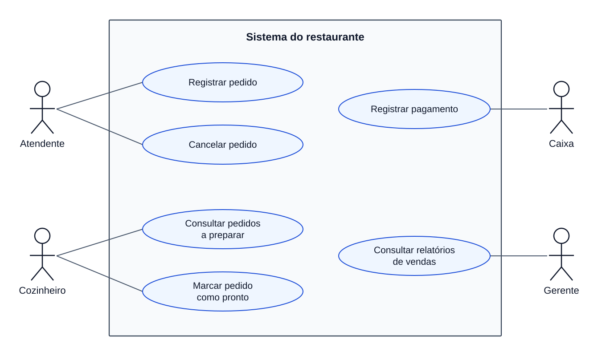
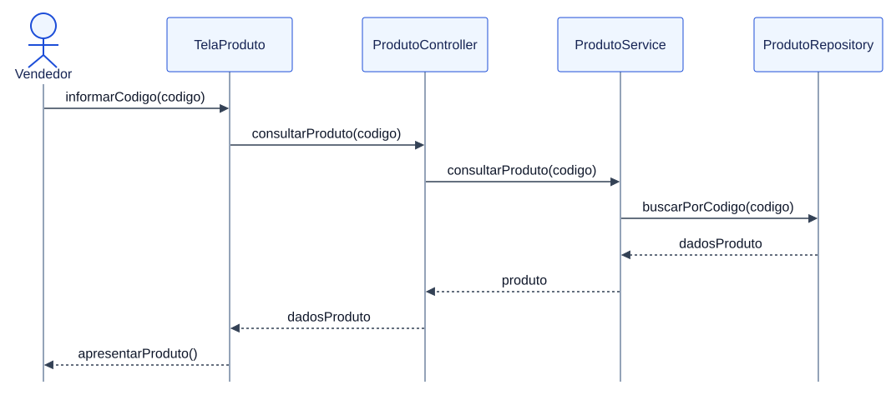
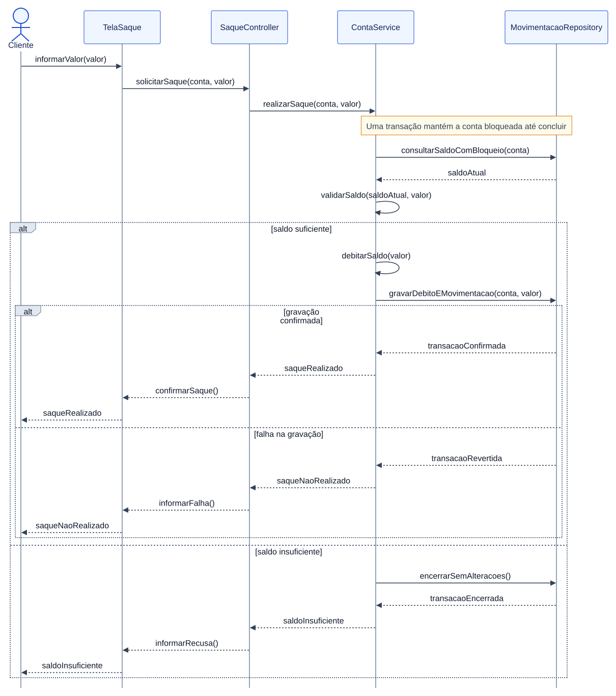
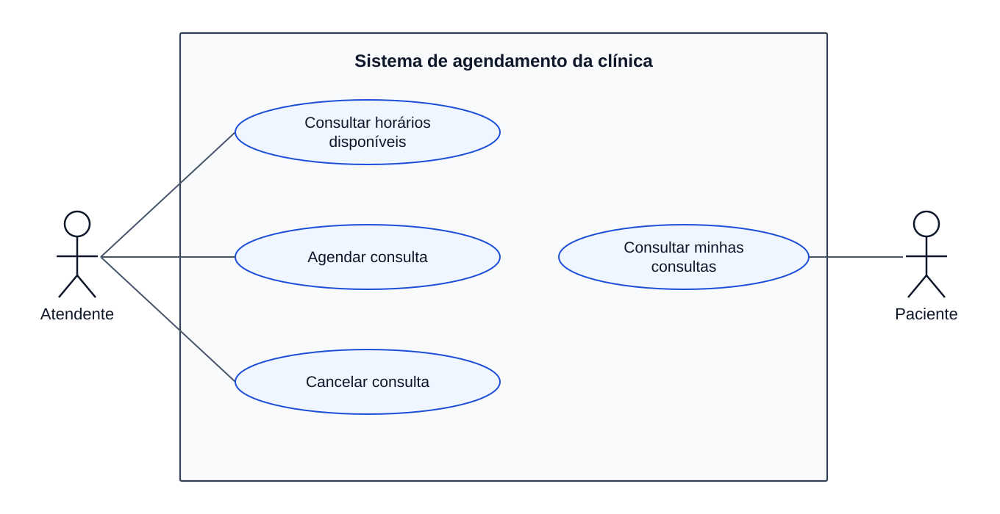
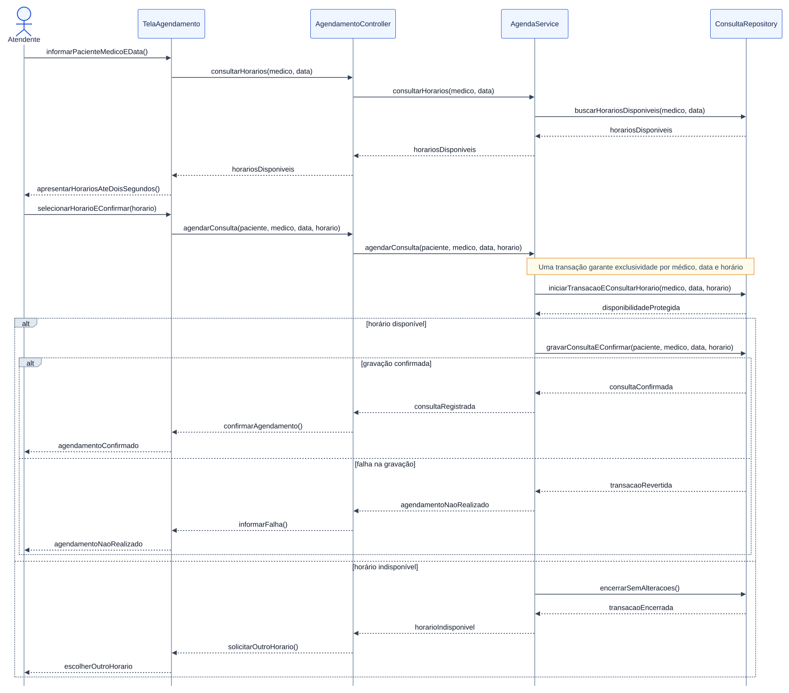

# Atividade 5

## Exercício 1

**a)** Podem surgir interpretações diferentes do mesmo pedido, funcionalidades incompatíveis, retrabalho e defeitos descobertos pelo cliente. Sem registros, fica difícil acompanhar mudanças, manter o sistema e recuperar o conhecimento de quem saiu da equipe.

**b)** Um processo de desenvolvimento de software organiza as atividades, responsabilidades e entregas necessárias para construir e manter um sistema. Ele permite que a equipe trabalhe com critérios conhecidos e acompanhe os resultados.

**c) e d)** No levantamento e análise de requisitos, a equipe conversa com o cliente, esclarece dúvidas e registra necessidades e critérios de aceitação. Isso reduz interpretações conflitantes e preserva o conhecimento.

No projeto do software, define a estrutura, os componentes e suas responsabilidades. Essas decisões registradas ajudam os desenvolvedores a manter uma solução consistente.

Na implementação, transforma o projeto em código, usando controle de versão e revisão. Assim, as alterações ficam rastreáveis e problemas podem ser identificados por outra pessoa.

Na validação, verifica o sistema por testes e avaliação com o cliente. Essa atividade encontra defeitos e confirma se as funcionalidades atendem às necessidades combinadas.

## Exercício 2

| Item | Classificação e justificativa |
|---|---|
| a | RN. A habilitação válida é uma condição para autorizar a locação. |
| b | RF. Registrar uma locação é uma operação oferecida pelo sistema. |
| c | RN. A diária mínima estabelece uma condição comercial da locação. |
| d | RNF de desempenho. Define o limite de três segundos para apresentar os veículos. |
| e | RF. Registrar a devolução é uma funcionalidade do sistema. |
| f | RN. A idade mínima restringe o acesso à categoria premium. |
| g | RNF de segurança. Restringe o acesso aos funcionários autenticados. A função de realizar login é um RF que atende a essa restrição. |

A RN define uma política ou restrição do negócio, mesmo sem software. O requisito de software determina uma função ou qualidade que o sistema deve oferecer para atender às necessidades identificadas.

## Exercício 3

| Identificação | Regra ou requisito |
|---|---|
| RN01 | Uma aula não pode ultrapassar seu limite de participantes. |
| RN02 | Um aluno não pode reservar aulas que ocorram no mesmo horário. |
| RN03 | Alunos com mensalidade vencida não podem fazer novos agendamentos. |
| RF01 | Permitir consultar as aulas disponíveis. |
| RF02 | Permitir reservar uma aula. |
| RF03 | Permitir cancelar uma reserva. |
| RNF01 | Apresentar o resultado da consulta de aulas disponíveis em até dois segundos. É de desempenho, pois limita o tempo de resposta. |

Uma RN pode afetar várias funcionalidades. A RN01 influencia a apresentação de vagas na consulta, a validação da reserva e a liberação da vaga após o cancelamento. Portanto, não existe uma relação obrigatória de uma regra para apenas um RF.

## Exercício 4

| Ator | Casos de uso com os quais interage |
|---|---|
| Bibliotecário | Registrar empréstimo, registrar devolução e autenticar acesso. |
| Aluno | Consultar livros disponíveis, consultar histórico de empréstimos e autenticar acesso. |
| Coordenador da biblioteca | Cadastrar livro, bloquear usuário e autenticar acesso. |
| Serviço externo de autenticação | Autenticar acesso, como serviço responsável por validar as credenciais. |

O serviço externo é um ator secundário: está fora da fronteira da biblioteca e participa da validação do acesso. Um ator pode representar uma pessoa, outro sistema ou um serviço.

Clicar em um botão, abrir uma tela e digitar matrícula são passos de uma interação. Sozinhos, normalmente não representam um objetivo completo com resultado de valor para o ator, como registrar um empréstimo.

## Exercício 5

**a) e b)** A especificação não informa o que será reservado, o que o cliente escolhe, quais dados são verificados, o que é salvo nem qual resultado confirma a conclusão. Também começa por uma tela sem explicar o objetivo da interação. Verbos vagos deixam cada leitor imaginar um comportamento diferente, dificultando a implementação e os testes.

**c)** Faltam objetivo, pré-condições, pós-condições, regras de negócio, requisitos relacionados e fluxos alternativos e de exceção. Também faltam os dados de entrada e as respostas esperadas do sistema.

**d)** Como o enunciado não define o negócio, considerei uma reserva de sala por um cliente autenticado. O fluxo principal abaixo assume disponibilidade no período solicitado.

| Etapa | Fluxo principal reescrito |
|---|---|
| P1 | O cliente solicita a reserva de uma sala e informa data, horário inicial e horário final. |
| P2 | O sistema valida o período e apresenta as salas disponíveis. |
| P3 | O cliente seleciona uma sala. |
| P4 | O sistema apresenta sala, data e horários para conferência. |
| P5 | O cliente confirma a reserva. |
| P6 | O sistema revalida a disponibilidade, registra a reserva vinculada ao cliente e apresenta o número de confirmação e os dados reservados. |

## Exercício 6

**UC01: Registrar Reserva**

| Elemento | Definição |
|---|---|
| Objetivo | Registrar a hospedagem de um cliente em um quarto disponível. |
| Ator principal | Atendente. |
| Pré-condições | Sistema disponível e atendente com acesso ao registro. |
| Pós-condição de sucesso | Reserva registrada para o cliente, quarto e período escolhidos. |
| Pós-condição de falha | Nenhuma reserva nova registrada. |
| Requisito relacionado | RF01: permitir que o atendente registre reservas. |

**Fluxo principal**

| Passo | Ação |
|---|---|
| P1 | Atendente informa o cliente, o quarto e as datas de entrada e saída. |
| P2 | Sistema verifica se a saída é posterior à entrada, conforme RN02. |
| P3 | Sistema verifica a disponibilidade do quarto e a ausência de outra reserva do cliente com período sobreposto, conforme RN01 e RN03. |
| P4 | Atendente confere os dados e confirma a reserva. |
| P5 | Sistema revalida a disponibilidade e os conflitos, registra a reserva e apresenta a confirmação. |

**Alternativo A1, em P3 ou P5:** se o quarto estiver indisponível, o sistema informa o conflito. O atendente escolhe outro quarto ou período e retoma P2.

**Alternativo A2, em P3 ou P5:** se o cliente já tiver reserva em período sobreposto, o sistema solicita outro período e retoma P2.

**Exceção E1, em P2:** datas inválidas impedem o registro. O sistema informa o problema e solicita a correção. Após corrigir as datas, o atendente retoma P2.

**Exceção E2, em P5:** uma falha de gravação desfaz a operação e informa que a reserva não foi registrada.

RN01, RN02 e RN03 orientam as validações indicadas no fluxo. RN04 estabelece cancelamento sem cobrança com antecedência mínima de 24 horas e pertence ao caso de uso Cancelar Reserva. O enunciado não define cobrança após esse prazo.

A coerência pode ser verificada relacionando cada regra ao passo que a aplica e conferindo cenários válidos e inválidos. No cancelamento, exatamente 24 horas de antecedência também deve permitir a gratuidade.

## Exercício 7

| Ator | Casos de uso associados |
|---|---|
| Atendente | Registrar pedido; Cancelar pedido. |
| Cozinheiro | Consultar pedidos para preparo; Marcar pedido como pronto. |
| Caixa | Registrar pagamento. |
| Gerente | Consultar relatórios de vendas. |

A fronteira delimita as funcionalidades do sistema. Os atores ficam fora dela, pois representam os papéis que interagem com o software.

O ator indica quem participa; o caso de uso representa um objetivo que esse participante realiza com o sistema. O diagrama mostra essas relações, sem definir a ordem das operações.

## Exercício 8

O vendedor informa o código à **TelaProduto**, que recebe a interação inicial. O **ProdutoController** coordena a entrada e a resposta da operação, encaminhando a consulta ao **ProdutoService**. O serviço executa a operação e solicita os dados ao **ProdutoRepository**, responsável pelo acesso à persistência.

O retorno percorre o caminho inverso até a tela apresentar o produto ao vendedor. A ordem vertical representa a evolução da interação: os dados precisam ser consultados antes de serem apresentados.

## Exercício 9

O fragmento `alt` apresenta caminhos condicionais: com saldo suficiente, ocorre o débito e o registro da movimentação; com saldo insuficiente, o cliente recebe a recusa.

Saldo, débito e movimentação participam de uma transação com bloqueio da conta. Isso impede que saques simultâneos utilizem o mesmo saldo. Se a gravação falhar, o débito é desfeito. A tela confirma o saque somente após a confirmação da transação.

## Exercício 10

**Regras e requisitos**

| Identificação | Definição |
|---|---|
| RN01 | Um médico não pode ter duas consultas no mesmo horário. |
| RN02 | Somente horários disponíveis podem ser agendados. |
| RF01 | Permitir que o atendente agende consultas. |
| RF02 | Permitir que o atendente cancele consultas. |
| RF03 | Permitir que o paciente consulte suas próprias consultas agendadas. |
| RF04 | Permitir consultar os horários disponíveis. |
| RNF01 | Apresentar os horários disponíveis em até dois segundos. |

RNF01 é um requisito de desempenho, pois estabelece um limite de tempo para a resposta.

**Caso de uso: Agendar Consulta**

| Elemento | Definição |
|---|---|
| Ator principal | Atendente. |
| Objetivo | Registrar uma consulta para o paciente. |
| Pré-condições | Paciente e médico identificados; atendente com acesso ao agendamento. |
| Pós-condição de sucesso | Consulta registrada no horário escolhido. |
| Pós-condição de falha | Nenhuma consulta nova registrada. |
| Relações | RF01 e RF04; RN01 e RN02. |

O paciente escolhe médico, data e horário e fornece os dados ao atendente, que realiza o registro.

| Passo | Fluxo principal |
|---|---|
| P1 | Atendente informa o paciente, o médico e a data. |
| P2 | Sistema apresenta os horários disponíveis em até dois segundos. |
| P3 | Atendente seleciona o horário escolhido pelo paciente e confirma. |
| P4 | Sistema verifica a disponibilidade e registra a consulta de forma atômica. |
| P5 | Sistema apresenta a confirmação. |

**Alternativo A1, em P4:** se o horário estiver indisponível, inclusive por outro agendamento simultâneo, o sistema não registra a consulta e solicita outra escolha, retomando P2.

**Exceção E1, em P4:** uma falha na gravação desfaz a operação e informa que o agendamento não foi concluído.

**Diagrama de casos de uso**

O atendente consulta horários, agenda e cancela consultas. O paciente consulta suas próprias consultas agendadas.

**Diagrama de sequência**

A tela recebe os dados; o controller coordena a solicitação; AgendaService aplica as regras; ConsultaRepository consulta e grava os dados. A confirmação revalida o horário na mesma transação da gravação, evitando reservas simultâneas. A resposta de sucesso chega após o registro ser confirmado.

**Integração dos conceitos**

| Artefato | Pergunta que ajuda a responder |
|---|---|
| Regra de negócio | Quais condições e restrições precisam ser respeitadas? |
| Requisito | O que o sistema deve oferecer e com qual qualidade? |
| Caso de uso | Como um ator alcança um objetivo usando o sistema? |
| Diagrama de casos de uso | Quem interage com quais funcionalidades? |
| Diagrama de sequência | Como os participantes trocam mensagens para realizar um cenário? |

[Enunciado da atividade](https://github.com/JoaoChoma/analise_projeto_esoft_2026/blob/main/atividades/1_bim/atividade05_revisao_master_class.md)
