# Atividade 6

Carolina Yumi Toyota, RA 143210

## Exercício 1

**a)** O Diagrama de Casos de Uso apresenta os objetivos dos atores e as funcionalidades oferecidas pelo sistema.

**b)** O Diagrama de Sequência mostra a ordem das mensagens trocadas entre participantes em um cenário.

**c)** O Diagrama de Classes apresenta a estrutura do sistema: classes, atributos, operações e relacionamentos.

**d)** Uma sequência não precisa mostrar todos os atributos, tipos, visibilidades, multiplicidades e relacionamentos permanentes entre as classes.

**e)** Os casos de uso definem o que o sistema deve oferecer. As sequências mostram como os participantes colaboram. O diagrama de classes organiza os dados e as responsabilidades necessárias para essas interações.

## Exercício 2

| Classe | Atributos propostos | Operações | Responsabilidade |
|---|---|---|---|
| Livro | `isbn: String`, `titulo: String` | `atualizarTitulo(titulo)` | Representar a obra cadastrada. |
| Exemplar | `tombo: String`, `situacao: SituacaoExemplar` | `estaDisponivel()`, `marcarEmprestado()`, `marcarDisponivel()` | Representar uma cópia física e controlar sua disponibilidade. |
| Aluno | `matricula: String`, `nome: String` | `atualizarNome(nome)` | Identificar quem realiza os empréstimos. |
| Emprestimo | `id: Long`, `dataEmprestimo: LocalDate`, `dataPrevista: LocalDate`, `dataDevolucao: LocalDate` opcional | `registrarDevolucao(data)`, `estaEmAberto()` | Registrar o empréstimo e sua devolução. |

| Relacionamento | Multiplicidade |
|---|---|
| Livro e Exemplar | Cada exemplar corresponde a um livro; um livro pode ter `0..*` exemplares. |
| Aluno e Emprestimo | Cada empréstimo pertence a um aluno; um aluno pode ter `0..*` empréstimos. |
| Exemplar e Emprestimo | Cada empréstimo registra um exemplar; um exemplar pode ter `0..*` empréstimos ao longo do tempo. |

Nem todo substantivo vira classe. Datas podem ser atributos e uma situação pode ser uma enumeração. Uma classe deve representar um conceito com dados e responsabilidades próprios. Para impedir empréstimos simultâneos do mesmo exemplar, é necessária uma restrição sobre os empréstimos em aberto, além das multiplicidades históricas.

## Exercício 3

**a)** Os compartimentos representam nome da classe, atributos e operações.

**b)** Atributos guardam o estado; operações definem comportamentos que a classe oferece.

**c)** `+` indica visibilidade pública e `-` indica visibilidade privada.

**d)** O tipo após os dois-pontos informa o tipo do atributo ou do resultado da operação. Por exemplo, `preco: Decimal` guarda um valor decimal.

**e)** Documentar operações mostra como usar a classe e quais responsabilidades ela assume, além dos dados armazenados.

**f)** A visibilidade controla o acesso aos membros. O encapsulamento usa esse controle para proteger o estado e permitir alterações por operações que preservem as regras do objeto.

## Exercício 4

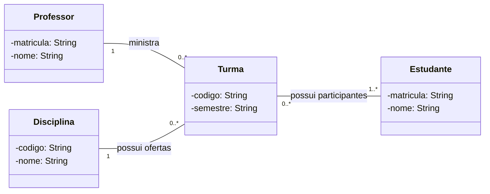

Considerei que uma turma em funcionamento tem pelo menos um estudante. O professor e a disciplina podem existir antes da abertura de turmas, e um estudante pode estar sem matrícula em turma.

| Multiplicidade | Significado |
|---|---|
| `1` | Exatamente um. |
| `0..1` | Nenhum ou um. |
| `0..*` | Nenhum ou vários. |
| `1..*` | Um ou vários. |

As multiplicidades orientam referências, coleções e validações. Uma coleção não garante sozinha a quantidade mínima ou a exclusividade do relacionamento.

## Exercício 5

**a)** No cenário A, agregação; no B, composição; no C, associação.

**b)** A associação representa um vínculo entre objetos. A agregação expressa uma relação todo-parte em que as partes têm identidade independente. A composição acrescenta pertencimento exclusivo e controle do ciclo de vida pelo todo.

**c)** Quando o todo deixa de existir, suas partes compostas também deixam de existir nesse modelo. A remoção dos registros persistidos precisa ser implementada; ela não acontece automaticamente por descartar uma referência em Java.

**d)** Uma referência apenas permite acessar outro objeto. Para usar composição, é necessário justificar propriedade exclusiva e dependência de ciclo de vida.

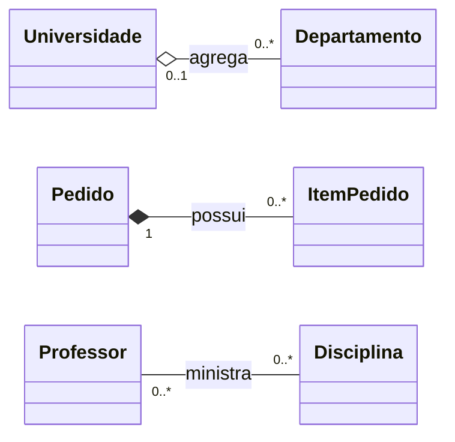

O departamento mantém sua identidade quando muda de universidade; `0..1` permite o período de transferência. Um item pertence a um único pedido e é criado e removido por ele; um pedido em rascunho pode estar vazio. Professor e disciplina mantêm identidades e ciclos de vida independentes, sem relação de propriedade.

## Exercício 6

**a)** Identificador, valor, data e situação pertencem a `Pagamento`.

**b)** Validar valor, consultar situação e registrar mudanças de situação podem ser compartilhados. `processar()` define um contrato comum, com implementação específica em cada modalidade.

**c)** Pix pode gerar uma cobrança e registrar o identificador da transação; cartão realiza autorização por token; boleto gera a linha digitável e controla o vencimento.

**d)**

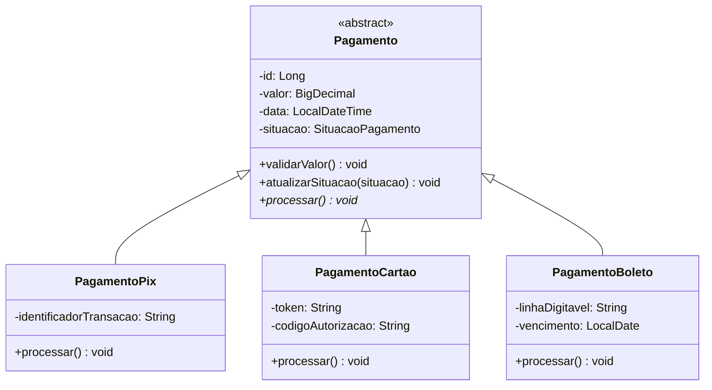

**e)** Herança representa especialização: um pagamento Pix é um pagamento. Composição representa um objeto formado por partes sob seu controle.

**f)** A herança prejudica a evolução quando a hierarquia serve apenas para reutilizar código, as subclasses precisam contrariar o contrato herdado ou mudanças na superclasse afetam muitos subtipos. Nesses casos, delegar a um objeto que implementa uma estratégia pode reduzir a dependência.

## Exercício 7

**a)** `Pedido` representa o pedido e deve preservar suas regras, itens e situação.

**b)** `PedidoService` coordena os casos de uso: carrega dados, solicita comportamentos do domínio e persiste o resultado.

**c)** `calcularTotal()`, `cancelar()` e `aplicarDesconto(valor)` podem ficar em `Pedido`. A autorização de um desconto pode envolver uma política ou serviço de domínio separado.

**d)** Uma única Service com todas as regras acumula responsabilidades, aumenta o acoplamento e facilita alterações que deixam o objeto em estado inválido.

**e)**

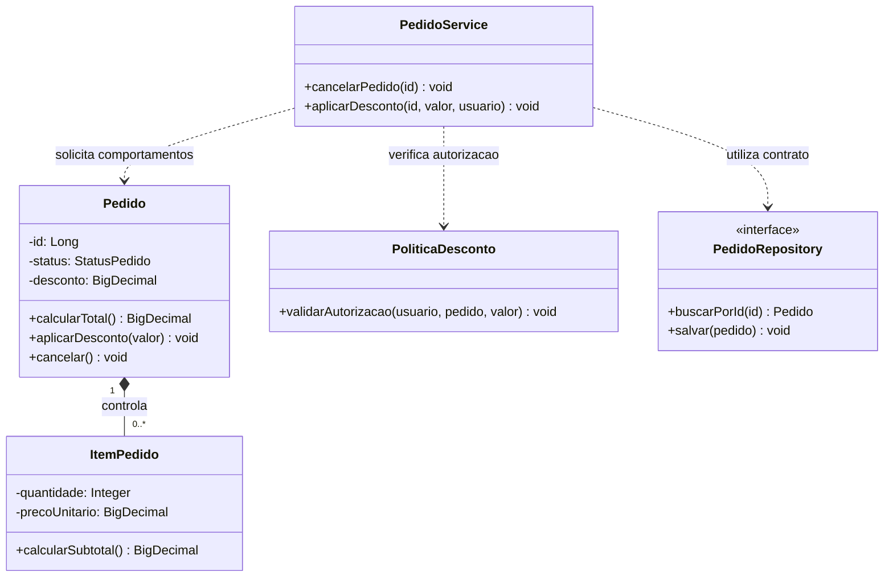

O pedido controla seus estados e limites do desconto. A política verifica a autorização; a Service coordena essas verificações e a persistência. Assim, uma regra que envolve outros conceitos não precisa ser forçada para dentro da entidade.

## Exercício 8

**a)** `SistemaManager` apresenta baixa coesão e concentra responsabilidades de assuntos diferentes.

**b)** Coesão é a relação entre as responsabilidades de uma classe. Uma classe coesa tem um propósito claro.

**c)** Acoplamento é o grau de dependência entre componentes. Dependências excessivas tornam as mudanças mais difíceis de isolar.

**d)** Alterar uma responsabilidade pode afetar funcionalidades sem relação com ela. Os testes passam a exigir muitas dependências e ficam mais difíceis de preparar.

**e) e f)** As regras ficam em classes específicas. Uma fachada opcional apenas encaminha as solicitações, sem reunir novamente as regras.

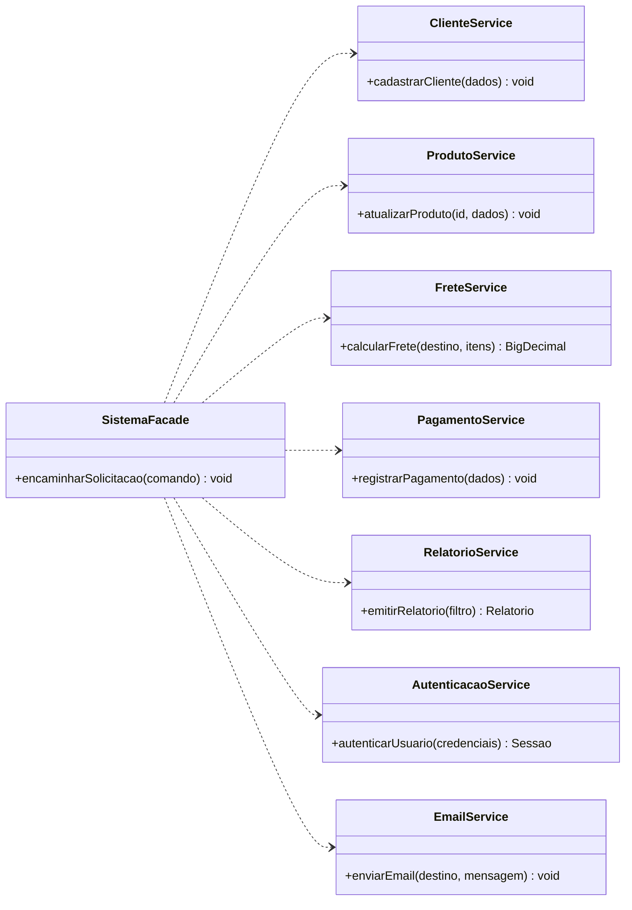

## Exercício 9

**a)** `TelaPedido`, `PedidoController` e `PedidoService` podem ser classes concretas. `PedidoRepository` pode ser um contrato com implementação concreta na infraestrutura. O participante `Cliente`, se representa a pessoa que usa o sistema, é um ator externo; uma entidade `Cliente` só aparece no domínio se o negócio precisar representá-la.

**b)** A tela e o controlador pertencem à interface. A Service coordena a aplicação. `Pedido` representa o domínio. O adaptador de persistência pertence à infraestrutura.

**c)** A cadeia apresentada não detalha as mensagens. A partir do objetivo, proponho `enviarPedido(dados)`, `registrar(dados)`, `registrarPedido(dados)` e `salvar(pedido)`.

**d)** Parâmetros e resultados das mensagens podem sugerir atributos, mas não definem toda a estrutura. É necessário confirmar os dados pelas regras e requisitos.

**e)**

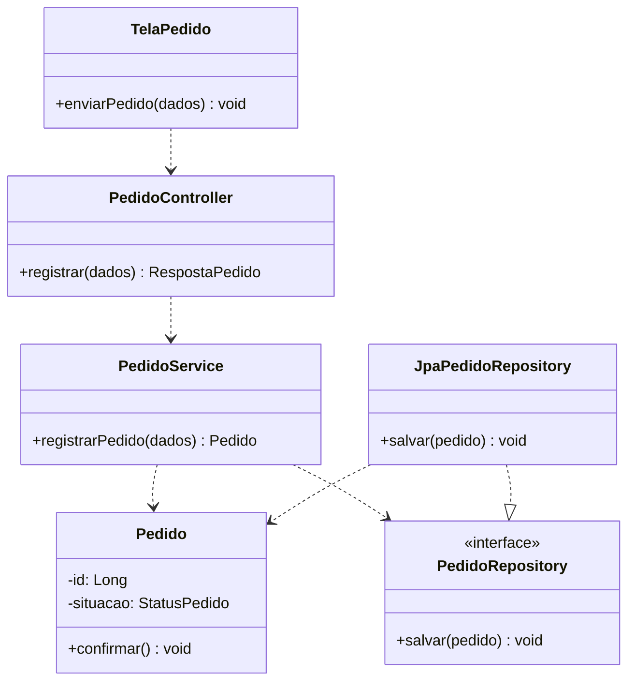

**f)** A sequência pode mostrar atores, telas, controladores e adaptadores. O diagrama de domínio seleciona os conceitos do negócio, por isso não precisa conter todos esses participantes técnicos.

## Exercício 10

| Item | Camada |
|---|---|
| 1. Receber requisições HTTP | Apresentação/Interface. |
| 2. Validar regras de negócio | Domínio. |
| 3. Coordenar um caso de uso | Aplicação. |
| 4. Consultar o banco | Infraestrutura. |
| 5. Representar uma entidade | Domínio. |
| 6. Converter dados recebidos | Apresentação, ao transformar a entrada HTTP em DTO. A construção de entidades pode ser coordenada pela aplicação. |
| 7. Persistir alterações | Infraestrutura, acionada pela aplicação por um contrato. |
| 8. Retornar resposta HTTP | Apresentação/Interface. |

**a) e b)**

| Camada | Finalidade | Exemplos |
|---|---|---|
| Apresentação | Adaptar entrada e saída para a interface usada. | `PedidoController`, `RegistrarPedidoRequest`, `PedidoResponse`. |
| Aplicação | Coordenar casos de uso, transações e contratos de acesso externo. | `PedidoService`, `PedidoRepository` como porta. |
| Domínio | Representar conceitos e preservar regras de negócio. | `Pedido`, `ItemPedido`, `Produto`, `PoliticaDesconto`. |
| Infraestrutura | Implementar persistência, integração e serviços técnicos. | `JpaPedidoRepository`, adaptador de e-mail. |

**c)** Camada lógica é uma separação de responsabilidades e dependências. Diretório é uma organização física dos arquivos.

**d)** A arquitetura não exige exatamente quatro diretórios. Módulos por funcionalidade também podem manter essas responsabilidades separadas.

**e)** A separação permite alterar uma interface ou a tecnologia de persistência com menor impacto nas regras e facilita testes isolados.

## Exercício 11

**a)** `ProdutoController` adapta HTTP; `ProdutoService` coordena os casos de uso; `Produto` mantém dados e comportamentos do negócio; `ProdutoRepository` define o contrato de acesso aos produtos.

**b)** `ProdutoController` recebe a requisição HTTP.

**c)** `ProdutoService` coordena o caso de uso.

**d)** `Produto` representa o domínio e preserva regras, como preço válido e estoque suficiente.

**e)** A aplicação acessa o contrato `ProdutoRepository`. `JpaProdutoRepository` implementa esse contrato na infraestrutura e acessa o banco.

**f)** Depender de um controlador HTTP prenderia a entidade a uma interface específica, dificultando testes e reutilização em outros canais.

**g)**

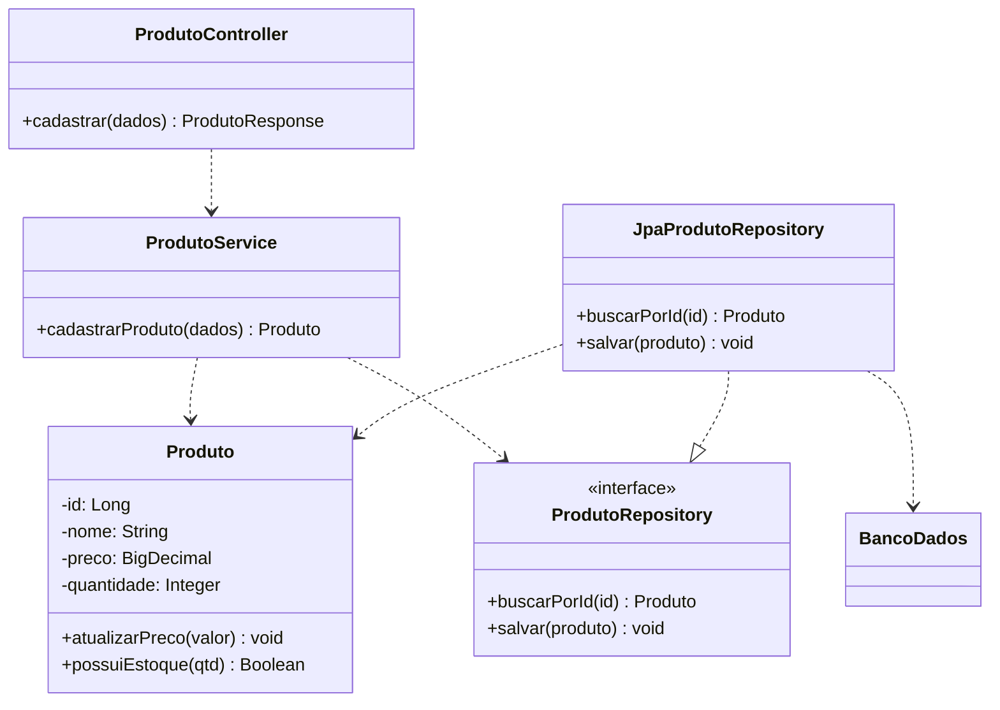

## Exercício 12

**a)** O controlador mistura HTTP, regras de preço, desconto e estoque. A ligação direta à persistência também pode acoplar o caso de uso à tecnologia do banco.

**b)** O acesso direto não é sempre incorreto. Uma operação simples de consulta pode usar um contrato de leitura diretamente, se a arquitetura permitir. O problema deste cenário é acumular regras e coordenação de negócio no controlador.

**c)** O controlador recebe os dados, a Service coordena o caso de uso, o domínio valida as regras e um adaptador implementa o contrato de repositório.

**d)** Estoque suficiente, preço permitido e cálculo de desconto pertencem ao domínio. Uma política de desconto pode representar regras que envolvem mais de uma entidade.

**e)** Carregar dados, chamar as operações do domínio, controlar a transação e salvar o resultado pertencem à aplicação.

**f)**

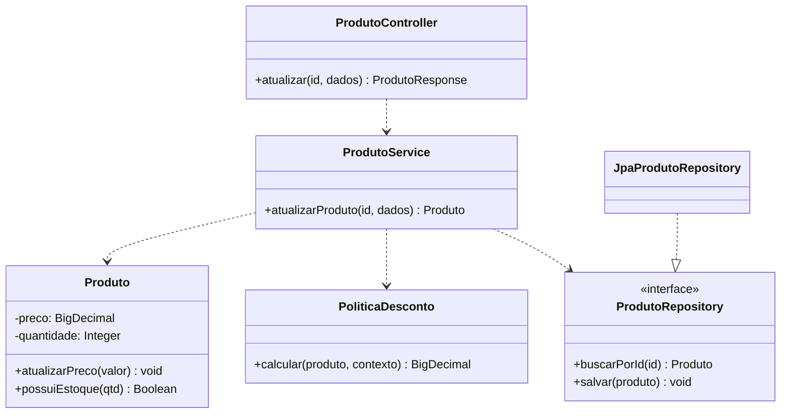

## Exercício 13

**a)** Com todos os arquivos juntos, fica mais difícil reconhecer responsabilidades, localizar o código de um caso de uso e definir limites entre funcionalidades.

**b)** Organização por camadas:

```text
src/main/java/sistema/
  apresentacao/
    ClienteController.java
    ProdutoController.java
    PedidoController.java
  aplicacao/
    ClienteService.java
    ProdutoService.java
    PedidoService.java
    portas/
      ClienteRepository.java
      ProdutoRepository.java
      PedidoRepository.java
  dominio/
    Cliente.java
    Produto.java
    Pedido.java
  infraestrutura/persistencia/
    JpaClienteRepository.java
    JpaProdutoRepository.java
    JpaPedidoRepository.java
```

**c)** Organização por funcionalidades, com responsabilidades internas:

```text
src/main/java/sistema/
  cliente/
    apresentacao/ClienteController.java
    aplicacao/ClienteService.java
    aplicacao/portas/ClienteRepository.java
    dominio/Cliente.java
    infraestrutura/JpaClienteRepository.java
  produto/
    apresentacao/ProdutoController.java
    aplicacao/ProdutoService.java
    aplicacao/portas/ProdutoRepository.java
    dominio/Produto.java
    infraestrutura/JpaProdutoRepository.java
  pedido/
    apresentacao/PedidoController.java
    aplicacao/PedidoService.java
    aplicacao/portas/PedidoRepository.java
    dominio/Pedido.java
    infraestrutura/JpaPedidoRepository.java
```

**d)** Por camadas, classes técnicas semelhantes ficam juntas, mas uma funcionalidade fica espalhada. Por funcionalidades, os arquivos do mesmo assunto ficam próximos, exigindo cuidado para manter limites internos claros.

**e)** A organização por funcionalidades facilita localizar o que pertence a `Registrar Pedido` no módulo `pedido`.

**f)** Para um sistema médio, escolheria módulos por funcionalidade com separação interna de responsabilidades. Isso aproxima o código do negócio e permite evoluir um módulo sem perder a distinção entre interface, aplicação, domínio e infraestrutura.

## Exercício 14

**a)** A estrutura A agrupa arquivos pela responsabilidade técnica. A B agrupa pelo assunto do negócio.

**b)** A favorece uma visão das camadas e padrões técnicos, mas espalha uma funcionalidade. B facilita compreender e alterar uma funcionalidade, mas pode criar dependências indevidas se não houver limites internos.

**c)** A destaca a arquitetura técnica; B destaca os módulos de negócio. As duas precisam documentar contratos e regras de dependência.

**d)** Diretórios não garantem boa arquitetura. Classes em pastas diferentes ainda podem misturar responsabilidades ou formar dependências circulares.

**e)** Cada módulo pode conter `apresentacao`, `aplicacao`, `dominio` e `infraestrutura`, como na proposta do exercício 13. A comunicação entre módulos ocorre por contratos públicos, preservando seus detalhes internos.

## Exercício 15

Para a rastreabilidade, adotei as referências do exercício 16: RN01 sobre disponibilidade, RF01 sobre registrar pedidos e UC01, Registrar Pedido.

| Campo | Descrição |
|---|---|
| Classe | `PedidoService`. |
| Responsabilidade | Coordenar o registro de um pedido válido e sua persistência. |
| Operação pública | `registrarPedido(Pedido pedido): void`. |
| Parâmetro | Pedido com cliente e itens informados, ainda sujeito à validação do caso de uso. |
| Resultado esperado | Pedido confirmado e persistido. A assinatura não retorna valor. |
| Falhas | Rejeitar pedido inválido ou estoque indisponível; falhas de persistência desfazem a transação. |
| Dependências | `Pedido`, `EstoqueService`, `PedidoRepository` e gerenciamento de transação. |
| RN relacionada | RN01: não confirmar quando algum produto estiver indisponível. |
| RF relacionado | RF01: permitir registrar pedidos. |
| UC relacionado | UC01: Registrar Pedido. |

Documentar a classe descreve sua responsabilidade, contrato e colaborações no projeto. Documentar o caso de uso descreve o objetivo do ator, os passos da interação e os resultados observáveis do sistema.

## Exercício 16

```text
RN01: não confirmar com produto indisponível
  -> RF01: permitir registrar pedidos
  -> UC01: Registrar Pedido
  -> validar disponibilidade antes da confirmação
  -> EstoqueService.verificarDisponibilidade(itens)
  -> Pedido.confirmar()
  -> PedidoRepository.salvar(pedido)
  -> pedido/aplicacao, pedido/dominio e pedido/infraestrutura
```

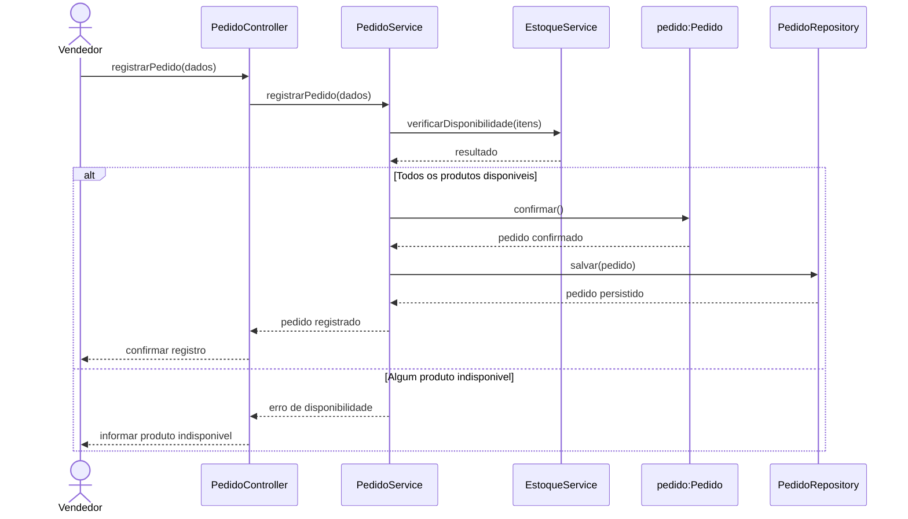

**a)** `Pedido`, `ItemPedido`, `Produto`, `PedidoController`, `PedidoService`, `EstoqueService` e os contratos e adaptadores de persistência.

**b)** `EstoqueService` coordena a verificação e proteção do saldo; `Produto` mantém a regra de quantidade disponível.

**c)** A aplicação solicita `Pedido.confirmar()` depois da validação de estoque.

**d)** A RN01 aparece no `alt`: o caminho de indisponibilidade não confirma nem persiste o pedido.

**e)** Uma matriz de rastreabilidade relaciona RN01 e UC01 a `EstoqueService.verificarDisponibilidade()`, `Produto.possuiEstoque()` e `Pedido.confirmar()`, além dos testes de estoque disponível e indisponível. Verificação/reserva e persistência devem participar da mesma transação, com controle de concorrência, para a regra continuar válida durante gravações simultâneas.

## Exercício 17

**a) e b)**

| Classe de domínio | Atributos | Operações |
|---|---|---|
| Produto | `id`, `nome`, `quantidade`, `versao` | `registrarEntrada(qtd, usuario, data)`, `registrarSaida(qtd, usuario, data)`. |
| Movimentacao | `id`, `tipo`, `quantidade`, `dataHora` | `consultarDados()`. Os dados registrados não são alterados. |
| Usuario | `id`, `nome` | `identificar()`. |
| TipoMovimentacao | `ENTRADA`, `SAIDA` | Enumeração usada pela movimentação. |

**c) e d)**

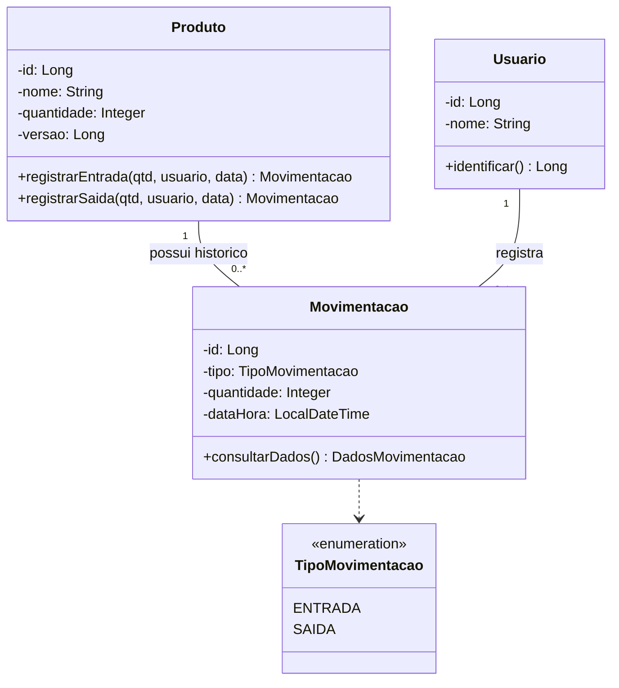

Cada movimentação identifica um produto e um usuário. Um produto ou usuário pode existir sem movimentações anteriores. Entradas e saídas exigem quantidade positiva e produzem uma movimentação imutável.

**e)** A aplicação pode ter `ProdutoService`, `MovimentacaoService`, `ConsultaEstoqueService`, `RelatorioMovimentacaoService` e um contrato `AutorizacaoGateway`. `MovimentacaoService` coordena autorização, alteração do saldo e gravação da movimentação.

**f)** A infraestrutura implementa os repositórios, a transação, o controle de versão concorrente e o adaptador de autenticação/autorização. A apresentação fornece controladores e DTOs para as operações.

**g)**

```text
src/main/java/br/edu/sistema/
  estoque/
    apresentacao/
      ProdutoController.java
      MovimentacaoController.java
      MovimentacaoRequest.java
    aplicacao/
      ProdutoService.java
      MovimentacaoService.java
      ConsultaEstoqueService.java
      RelatorioMovimentacaoService.java
      portas/
        ProdutoRepository.java
        MovimentacaoRepository.java
        AutorizacaoGateway.java
    dominio/
      Produto.java
      Movimentacao.java
      TipoMovimentacao.java
    infraestrutura/
      JpaProdutoRepository.java
      JpaMovimentacaoRepository.java
      AutorizacaoAdapter.java
  usuario/dominio/
    Usuario.java
```

**h)**

| Regra | Aplicação na proposta |
|---|---|
| RN01 | `Produto.registrarSaida()` rejeita quantidade maior que o saldo. A transação e o controle de versão impedem que saídas simultâneas produzam saldo negativo. |
| RN02 | `Produto.registrarEntrada()` altera o saldo e produz uma movimentação de entrada, gravados juntos pela aplicação. |
| RN03 | `Produto.registrarSaida()` produz uma movimentação de saída, gravada na mesma transação da alteração do saldo. |
| RN04 | A aplicação consulta `AutorizacaoGateway` com a identidade autenticada antes de registrar uma movimentação. Estar autenticado não substitui possuir a permissão necessária. |

## Exercício 18

### Etapa 1

| RF | Requisito funcional |
|---|---|
| RF01 | Permitir cadastrar clientes. |
| RF02 | Permitir cadastrar produtos. |
| RF03 | Permitir consultar produtos e disponibilidade. |
| RF04 | Permitir registrar um pedido associado a um cliente. |
| RF05 | Permitir adicionar produtos e quantidades ao pedido. |
| RF06 | Calcular o total com os descontos autorizados. |
| RF07 | Permitir confirmar um pedido válido. |
| RF08 | Permitir cancelar pedidos ainda não enviados. |
| RF09 | Permitir consultar o histórico de pedidos. |

Os requisitos não funcionais abaixo são propostas para validação com o cliente.

| RNF | Requisito não funcional proposto |
|---|---|
| RNF01 | Registrar pedido e reservar estoque de forma atômica, sem confirmação parcial. |
| RNF02 | Impedir que registros simultâneos confirmem mais unidades que o estoque disponível. |
| RNF03 | Restringir as operações aos perfis autorizados e identificar quem confirmou ou cancelou um pedido. |
| RNF04 | Apresentar consultas de produtos em até dois segundos em 95% das solicitações, com até 100 usuários simultâneos. |

| Ator proposto | Casos de uso |
|---|---|
| Vendedor | UC01 Registrar Pedido, UC02 Cadastrar Cliente, UC03 Consultar Produtos, UC04 Consultar Histórico, UC05 Cancelar Pedido. |
| Responsável pelo catálogo | UC06 Cadastrar Produto. |
| Supervisor comercial | UC07 Autorizar Desconto, quando a política exigir uma aprovação. |

Adicionar produtos, calcular total e confirmar fazem parte do fluxo de UC01. O cliente é a entidade associada ao pedido; o cenário não afirma que ele opera diretamente a aplicação. Perfis e limites de autorização precisam ser acordados com a empresa.

### Etapa 2

| Campo | Especificação |
|---|---|
| Caso de uso | UC01: Registrar Pedido. |
| Objetivo | Registrar e confirmar um pedido para um cliente, com itens válidos e total calculado. |
| Ator principal | Vendedor. |
| Pré-condições | Vendedor autenticado e autorizado; cliente e produtos cadastrados. |
| Pós-condições de sucesso | Pedido confirmado e persistido com cliente, itens, preços e desconto aplicado; estoque reservado para o pedido. |
| Garantia em falha | A operação não deixa pedido confirmado nem reserva parcial de estoque. |
| RF relacionados | RF03, RF04, RF05, RF06 e RF07. |
| RN relacionadas | RN01, RN02, RN03, RN04 e RN05. RN06 governa o cancelamento posterior, em UC05. |

| Passo | Fluxo principal |
|---|---|
| 1 | O vendedor inicia um pedido e seleciona o cliente. |
| 2 | O sistema verifica o cliente e apresenta os produtos para consulta. |
| 3 | O vendedor informa um produto e sua quantidade. |
| 4 | O sistema verifica quantidade positiva e estoque suficiente e inclui o item no rascunho. |
| 5 | Os passos 3 e 4 se repetem para os demais produtos. |
| 6 | O sistema apresenta os itens, os subtotais, o desconto autorizado e o total. |
| 7 | O vendedor solicita a confirmação. |
| 8 | O sistema revalida cliente, itens, desconto e estoque, reserva as unidades e confirma o pedido. |
| 9 | O sistema persiste o pedido e a reserva na mesma transação e apresenta a identificação do registro. |

| Fluxo | Tratamento |
|---|---|
| A1. Produto sem estoque, no passo 4 | Informar a indisponibilidade; o vendedor ajusta a quantidade ou escolhe outro produto. |
| A2. Desconto solicitado, no passo 6 | Validar a autorização e recalcular o total. Desconto não autorizado é recusado. |
| A3. Desistência antes do passo 7 | Descartar o rascunho sem confirmar pedido ou reservar estoque. |
| A4. Cliente inválido ou pedido vazio | Impedir a confirmação e solicitar correção. |
| E1. Estoque alterado por outra operação | Rejeitar a confirmação, desfazer a transação e apresentar os itens afetados. |
| E2. Falha de persistência | Desfazer confirmação e reserva e informar que o pedido não foi registrado. |

### Etapa 3

O diagrama detalha a confirmação do rascunho dos passos 7 a 9. O vendedor já selecionou cliente e itens na tela. `EstoqueService` é um serviço de aplicação que coordena o acesso ao estoque; as regras de quantidade permanecem no domínio. A transação começa após a confirmação do vendedor.

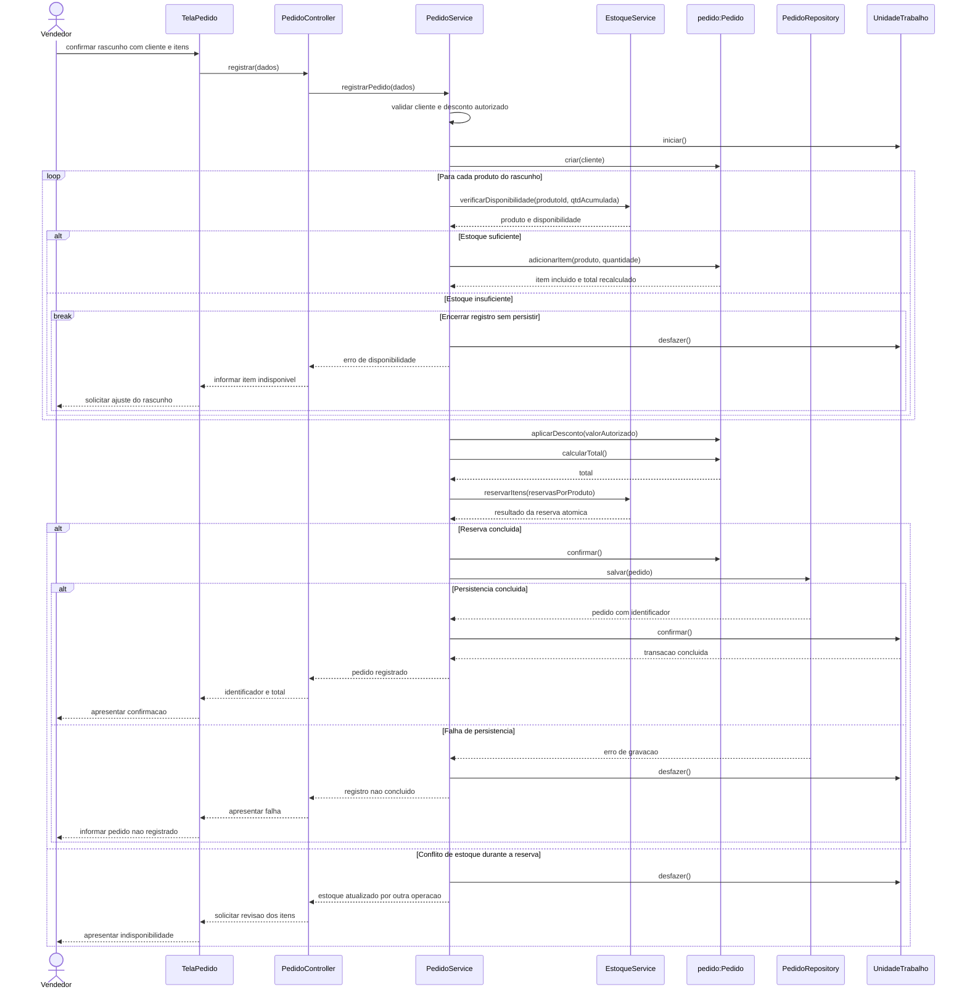

As quantidades do mesmo produto são consolidadas antes da verificação. Para a reserva, a aplicação monta objetos `ReservaEstoque` com identificador do produto e quantidade, sem passar entidades de pedido ao módulo de produtos. A reserva é atômica, revalida o saldo e participa da mesma transação da gravação do pedido. A validação de cliente e desconto também pode rejeitar a solicitação antes de iniciar essa transação. Falha na confirmação da transação segue E2, sem apresentar sucesso ao vendedor.

### Etapa 4

| Classe ou contrato | Responsabilidade | Atributos ou dependências principais | Operações |
|---|---|---|---|
| Cliente | Identificar o cliente do pedido. | `id`, `nome`. | `atualizarNome()`. |
| Produto | Manter preço e disponibilidade. | `id`, `nome`, `preco`, `quantidadeDisponivel`, `versao`. | `possuiEstoque()`, `reservar()`, `liberarReserva()`. |
| Pedido | Controlar itens, desconto, total e situação. | `id`, `cliente`, `itens`, `desconto`, `status`. | `adicionarItem()`, `calcularTotal()`, `confirmar()`, `cancelar()`. |
| ItemPedido | Manter quantidade e preço praticado no pedido. | `produto`, `quantidade`, `precoUnitario`. | `calcularSubtotal()`. |
| StatusPedido | Representar os estados do pedido. | `RASCUNHO`, `CONFIRMADO`, `ENVIADO`, `CANCELADO`. | Enumeração. |
| PedidoController | Adaptar requisição e resposta HTTP. | `PedidoService`. | `registrar()`, `cancelar()`, `consultarHistorico()`. |
| PedidoService | Coordenar os casos de uso de pedidos. | Repositórios, `EstoqueService`, `PoliticaDesconto`, `UnidadeTrabalho`. | `registrarPedido()`, `cancelarPedido()`, `consultarHistorico()`. |
| EstoqueService | Coordenar consulta, reserva e liberação de estoque. | `ProdutoRepository`; recebe solicitações `ReservaEstoque`. | `verificarDisponibilidade()`, `reservarItens()`, `liberarItens()`. |
| PoliticaDesconto | Validar limites e autorização do desconto. | Política comercial e contexto de autorização. | `validarAutorizacao()`. |
| ClienteService e ProdutoService | Coordenar os cadastros e consultas respectivos. | Contratos de repositório dos módulos. | `cadastrarCliente()`, `cadastrarProduto()`, `consultarProdutos()`. |
| ClienteController e ProdutoController | Adaptar as operações dos respectivos módulos. | Services e DTOs. | `cadastrar()`, `consultar()`. |
| PedidoRepository | Definir persistência e consulta de pedidos. | Contrato da aplicação. | `salvar()`, `buscarPorId()`, `buscarHistorico()`. |
| ProdutoRepository | Definir acesso e gravação de produtos com controle de concorrência. | Contrato da aplicação. | `buscarPorId()`, `salvar()`. |
| ClienteRepository | Definir acesso aos clientes. | Contrato da aplicação. | `buscarPorId()`, `salvar()`. |
| JpaPedidoRepository, JpaProdutoRepository e JpaClienteRepository | Implementar os contratos usando a persistência. | Mapeamento e acesso ao banco. | Implementar as operações dos contratos. |
| UnidadeTrabalho | Definir o limite transacional do caso de uso. | Contrato implementado na infraestrutura. | `iniciar()`, `confirmar()`, `desfazer()`. |
| RegistrarPedidoRequest e PedidoResponse | Transportar os dados da interface. | Cliente, itens e desconto solicitado; identificação, situação e total na resposta. | DTOs. |

### Etapa 5

**Domínio.**

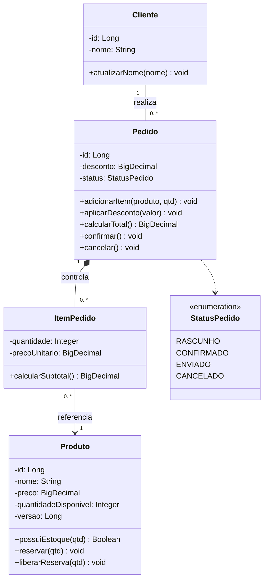

**Aplicação, contratos e adaptadores.** As entidades referenciadas abaixo estão detalhadas no diagrama de domínio.

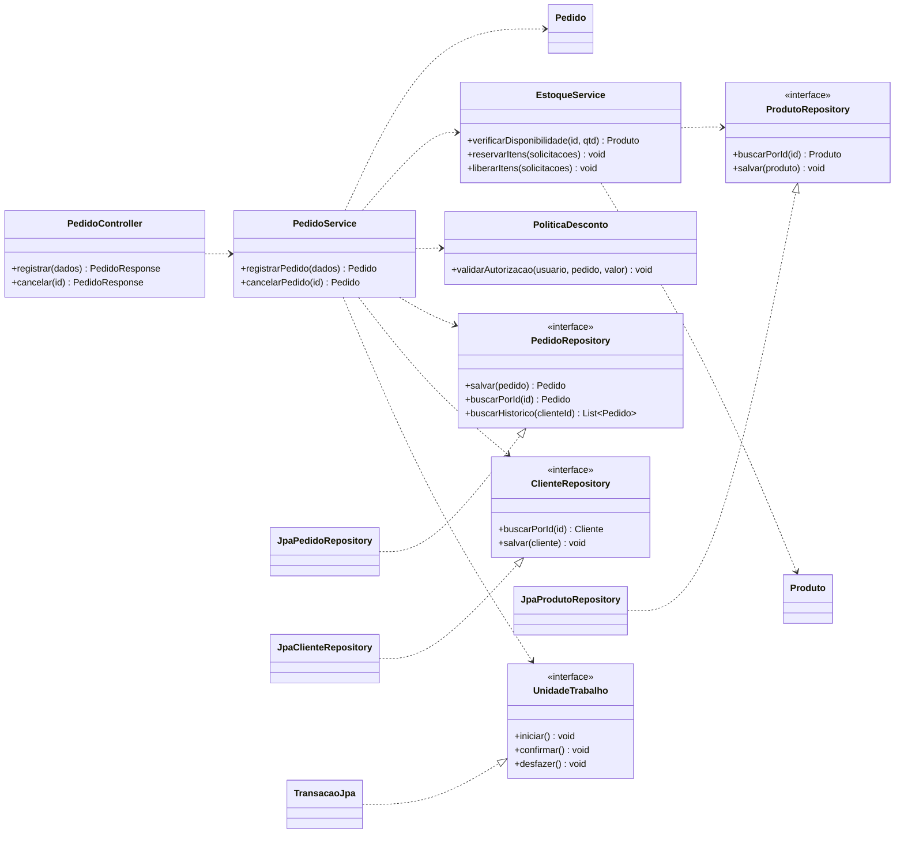

O rascunho admite zero itens; `confirmar()` exige pelo menos um. Cada item pertence exclusivamente a um pedido e guarda o preço praticado, preservando o histórico quando o catálogo muda. Pedidos confirmados ou enviados não aceitam alterações nos itens. `cancelar()` rejeita pedidos enviados e cancelamentos repetidos; a aplicação libera a reserva de um pedido confirmado na mesma transação do cancelamento.

O cálculo usa `total = soma(quantidade * precoUnitario) - descontoAutorizado`. O desconto não pode ser negativo nem ultrapassar a soma dos subtotais.

### Etapa 6

| Camada | Organização |
|---|---|
| Apresentação | Controladores, DTOs e conversão de erros para respostas HTTP. A tela apresenta os dados e coleta as ações do vendedor. |
| Aplicação | Services coordenam cadastro, registro, consulta e cancelamento. As portas de repositório e de transação definem as dependências externas necessárias. |
| Domínio | Entidades, estados e política de desconto preservam as regras sem depender de HTTP ou de JPA. Valores monetários usam `BigDecimal`. |
| Infraestrutura | Adaptadores JPA implementam as portas e o controle transacional/concorrente. A configuração conecta as implementações às Services. |

Apresentação depende dos contratos de aplicação. Aplicação depende do domínio e das portas. Infraestrutura depende dessas portas para implementá-las e pode conhecer o domínio para realizar o mapeamento. O domínio não depende dos controladores nem dos adaptadores.

Essa organização não é uma fila obrigatória de quatro camadas. Pela inversão de dependência, a aplicação usa uma interface que a infraestrutura implementa. A chamada em execução pode chegar ao adaptador, enquanto a dependência do código aponta do adaptador para o contrato. Devem ser evitados ciclos entre módulos, acesso de entidades ao HTTP e regras comerciais dentro de repositórios concretos.

### Etapa 7

```text
src/main/java/br/edu/sistema/
  cliente/
    apresentacao/
      ClienteController.java
      ClienteRequest.java
      ClienteResponse.java
    aplicacao/
      ClienteService.java
      portas/ClienteRepository.java
    dominio/Cliente.java
    infraestrutura/JpaClienteRepository.java
  produto/
    apresentacao/
      ProdutoController.java
      ProdutoRequest.java
      ProdutoResponse.java
    aplicacao/
      ProdutoService.java
      EstoqueService.java
      ReservaEstoque.java
      portas/ProdutoRepository.java
    dominio/Produto.java
    infraestrutura/JpaProdutoRepository.java
  pedido/
    apresentacao/
      PedidoController.java
      RegistrarPedidoRequest.java
      ItemPedidoRequest.java
      PedidoResponse.java
    aplicacao/
      PedidoService.java
      portas/PedidoRepository.java
    dominio/
      Pedido.java
      ItemPedido.java
      StatusPedido.java
      PoliticaDesconto.java
    infraestrutura/JpaPedidoRepository.java
  compartilhado/
    aplicacao/portas/UnidadeTrabalho.java
    infraestrutura/TransacaoJpa.java
  configuracao/
    ConfiguracaoDependencias.java
```

### Etapa 8

**Visão geral.** A proposta é um monólito modular com os módulos `cliente`, `produto` e `pedido`. O vendedor registra pedidos; o catálogo fornece os produtos e a disponibilidade; a aplicação mantém confirmação, reserva e persistência consistentes.

**Decisões arquiteturais.** Módulos por funcionalidade aproximam os arquivos dos casos de uso. As responsabilidades internas separam interface, coordenação, regras e persistência. Contratos permitem substituir adaptadores e testar as Services sem banco. `Pedido` controla seus itens por composição e não expõe uma coleção mutável. Reserva e gravação usam uma transação compartilhada, com controle concorrente do saldo. A reserva é uma decisão desta proposta para evitar que duas confirmações comprometam as mesmas unidades.

**Árvore comentada e responsabilidades.** Na árvore da etapa 7, `apresentacao` adapta a interface; `aplicacao` executa casos de uso; `dominio` protege as regras; `infraestrutura` implementa persistência. `ReservaEstoque` transporta identificadores e quantidades para a API do módulo de produtos. `compartilhado` contém apenas o contrato transacional comum e seu adaptador. `configuracao` monta as dependências. As operações e responsabilidades das classes estão na etapa 4; os diagramas estão nas etapas 3 e 5.

**Rastreabilidade.**

| Regra | RF e UC | Classes e operações responsáveis |
|---|---|---|
| RN01. Cliente obrigatório | RF04; UC01. | `PedidoService.registrarPedido()` consulta `ClienteRepository`; a construção de `Pedido` exige cliente. |
| RN02. Pelo menos um item | RF05 e RF07; UC01. | `Pedido.confirmar()` rejeita uma coleção vazia. |
| RN03. Estoque suficiente | RF03, RF05 e RF07; UC01. | `EstoqueService.verificarDisponibilidade()`, `Pedido.adicionarItem()`, `Produto.possuiEstoque()` e reserva concorrente. |
| RN04. Total e desconto autorizado | RF06; UC01 e, quando aplicável, UC07. | `ItemPedido.calcularSubtotal()`, `Pedido.calcularTotal()`, `Pedido.aplicarDesconto()` e `PoliticaDesconto.validarAutorizacao()`. |
| RN05. Bloqueio dos itens após confirmação | RF05 e RF07; UC01. | `Pedido.adicionarItem()` e demais alterações de itens exigem estado `RASCUNHO`; a coleção é protegida. |
| RN06. Cancelar somente antes do envio | RF08; UC05. | `Pedido.cancelar()` verifica o estado; `PedidoService.cancelarPedido()` coordena liberação de reserva e persistência. |

**Dependências entre módulos.** `pedido` acessa a consulta pública de clientes e a API de estoque de `produto`. `cliente` e `produto` não dependem de `pedido`; para a reserva, recebem identificadores e quantidades, sem conhecer suas entidades. Os módulos de negócio não acessam os adaptadores internos uns dos outros. A configuração pode conhecer as implementações para conectá-las, sem concentrar regras comerciais.
